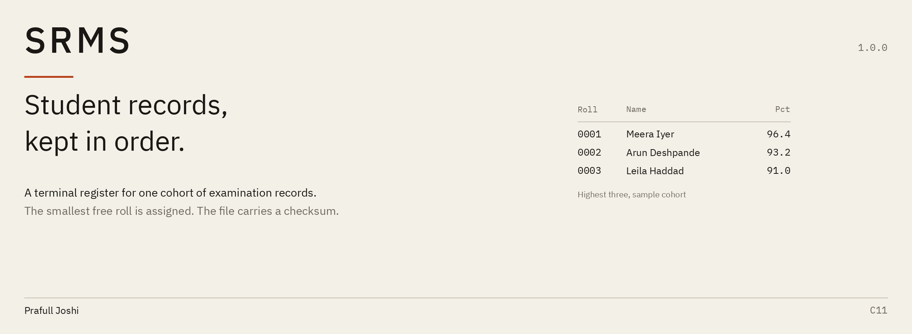
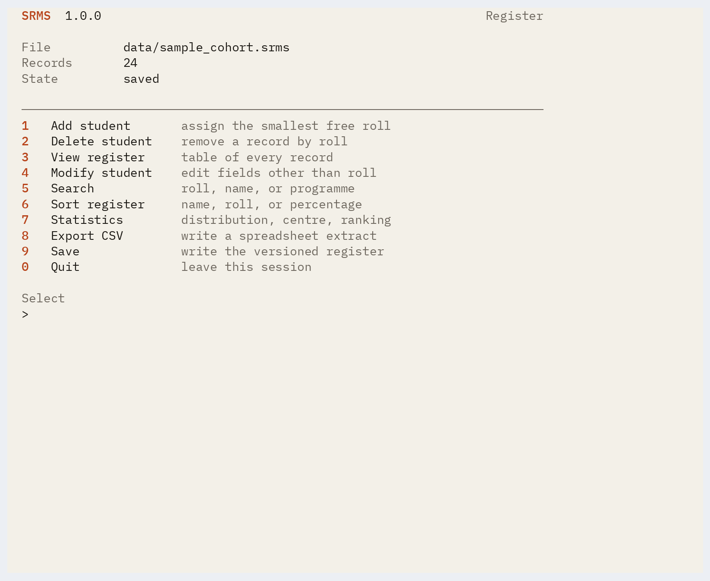
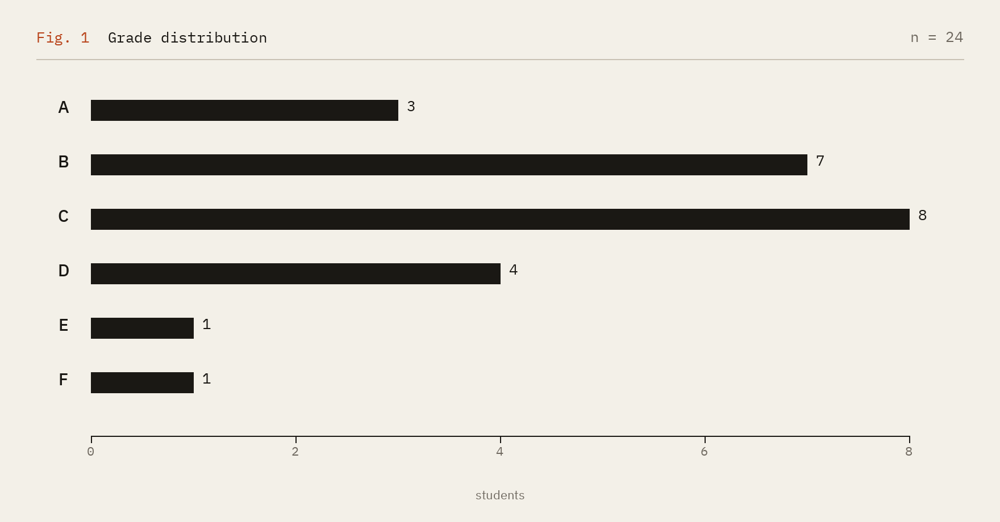
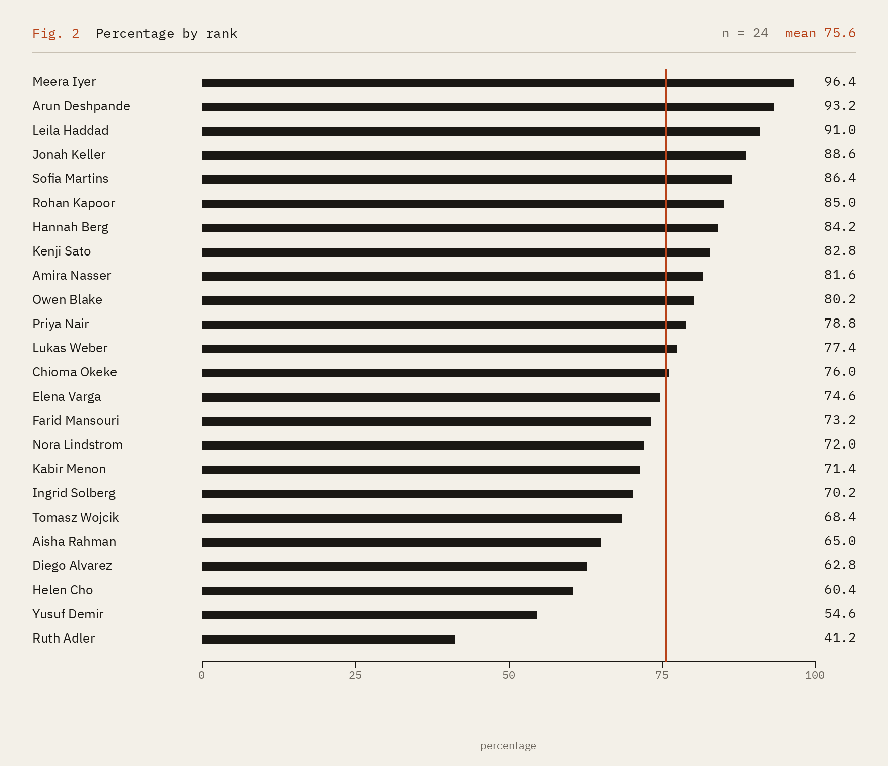
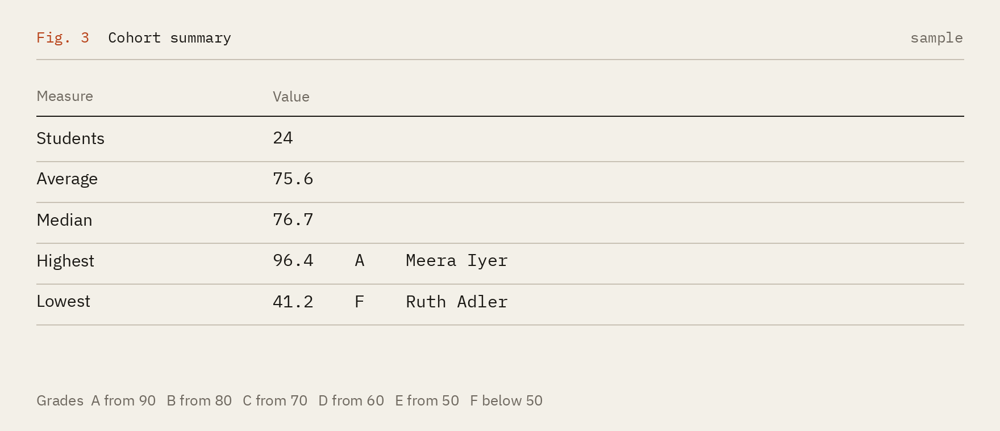
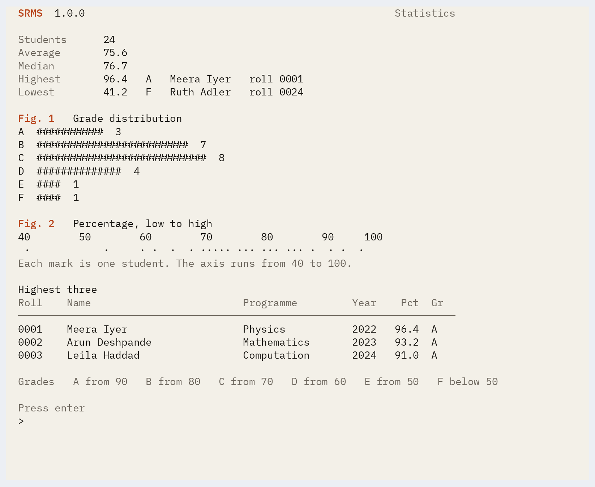
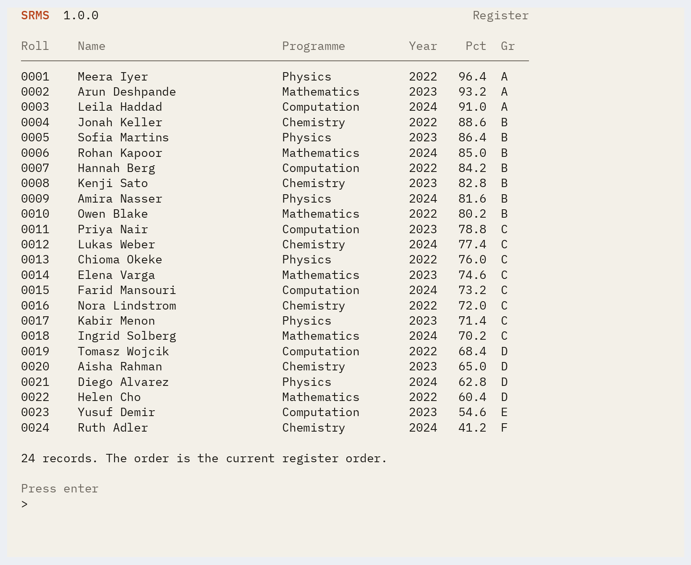
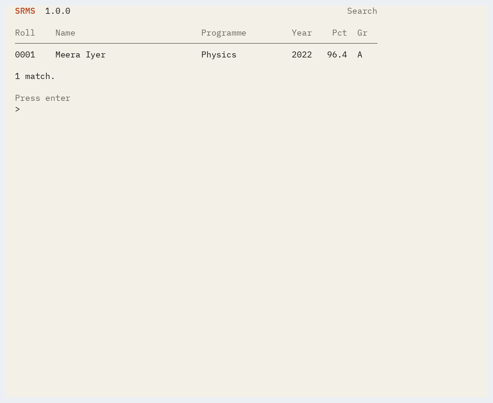
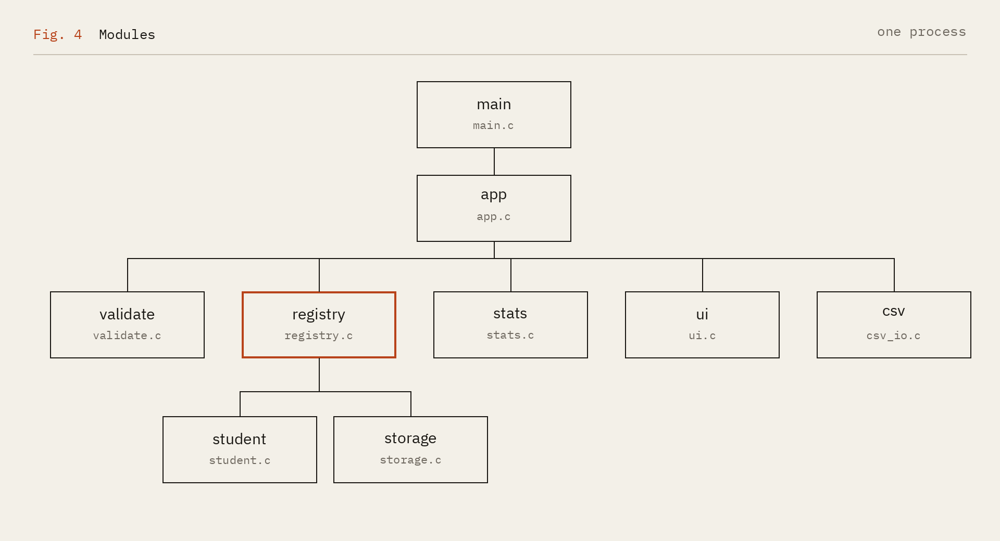
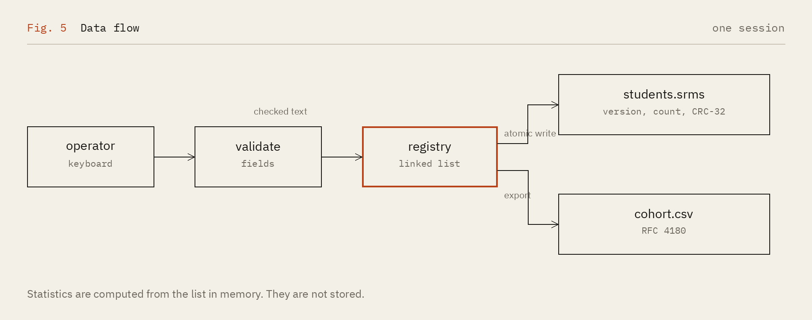

# SRMS

<picture>
  <source media="(prefers-color-scheme: dark)" srcset="docs/assets/banner-dark.png">
  
</picture>

A terminal register for one cohort of examination records: a linked list in memory, a checksummed file on disk, and class statistics on request.

[](https://github.com/PrafullJ0shi/student-record-system/actions/workflows/ci.yml)
[](LICENSE)
[](https://github.com/PrafullJ0shi/student-record-system)
[](CHANGELOG.md)

## Session

The program is a menu. Rolls are assigned. Nothing reaches disk until Save.



Fig. 6 — A session on the sample cohort of 24 students. The same recording is [demo.mp4](docs/assets/demo.mp4).

## What a record holds

Each student has a roll, a name, a programme, a year of admission, and five marks: Paper I, Paper II, Paper III, Paper IV, and Practical. Marks are stored as tenths, from 0.0 to 100.0. The percentage is the mean of the five, rounded half up to one decimal. Grades run A from 90, B from 80, C from 70, D from 60, E from 50, and F below 50.

The roll is the smallest positive integer not already in the list. Delete roll 2 and the next student added receives 2. The roll itself is not edited.

Search takes a roll exactly, or a case-insensitive substring of the name or the programme. Sort is a stable merge sort on roll, name, or percentage, ascending or descending. The new order is part of the session and is written only when you save.

## Statistics

Figures below are drawn from `data/sample_cohort.srms`.

<picture>
  <source media="(prefers-color-scheme: dark)" srcset="docs/assets/fig-01-grades-dark.png">
  
</picture>

Fig. 1 — Grade distribution. Bar length is the headcount. The scale is fixed at 8.

<picture>
  <source media="(prefers-color-scheme: dark)" srcset="docs/assets/fig-02-percentage-dark.png">
  
</picture>

Fig. 2 — Percentage by rank. The accent line is the mean, 75.6. The median is 76.7.

<picture>
  <source media="(prefers-color-scheme: dark)" srcset="docs/assets/fig-03-summary-dark.png">
  
</picture>

Fig. 3 — Cohort summary.

On the terminal, the same numbers are printed with a grade histogram and a one-row strip of the 24 percentages.



Fig. 7 — Statistics for the sample cohort.



Fig. 8 — The register, in file order.



Fig. 9 — Search for `Iyer`.

## Modules

<picture>
  <source media="(prefers-color-scheme: dark)" srcset="docs/assets/fig-04-modules-dark.png">
  
</picture>

Fig. 4 — Modules. The vector plate is [fig-04-modules.svg](docs/assets/fig-04-modules.svg). Notes are in [docs/ARCHITECTURE.md](docs/ARCHITECTURE.md).

<picture>
  <source media="(prefers-color-scheme: dark)" srcset="docs/assets/fig-05-flow-dark.png">
  
</picture>

Fig. 5 — Data flow. The vector plate is [fig-05-flow.svg](docs/assets/fig-05-flow.svg).

## Build

The compilers tested are gcc and clang. The language is C11.

```sh
make
make test
./build/srms --file data/sample_cohort.srms
```

CMake:

```sh
cmake -S . -B build -DCMAKE_BUILD_TYPE=Release
cmake --build build
ctest --test-dir build --output-on-failure
./build/srms --file data/sample_cohort.srms
```

`make san`, or `-DSRMS_SANITIZERS=ON`, builds with AddressSanitizer and UndefinedBehaviorSanitizer.

```text
srms [--file PATH] [--color | --no-color] [--ascii]
srms --file PATH --import-csv FILE
srms --file PATH --export-csv FILE
srms --file PATH --stats
srms --file PATH --report FILE
```

The default register is `students.srms` in the working directory. Colour follows the terminal unless `NO_COLOR` is set. `--color` forces it. `--ascii` replaces the rules and the histogram blocks. `--report -` writes a tab-separated summary to stdout.

A new register is created in memory when the file is missing. A file that fails its version check, its checksum, or a field check is not opened for editing.

## Tree

```text
include/srms/     public headers
src/              the library and main
tests/            unit tests and a command smoke test
data/             the sample cohort, CSV and register
docs/             design, architecture, format, decisions
docs/assets/      plates, screens, the session
.github/          CI, release, issue forms, social preview
```

## Roadmap

- A second sitting in the same register, without breaking version 1 files.
- An optional note on a student, as format version 2.
- Paging when a cohort is longer than the screen.
- A textual diff of two register files.

## V2 roadmap

Planned for V2, not shipped. The items above stay on the list; V2 adds ten features aimed at the people who keep marks for a living and the developers who connect SRMS to other tools. The core stays a single C11 program under the MIT licence.

1. **Configurable grading schemes.** Grade bands, a 10-point grade-point scale, credit weights per paper and pass rules (for example, a practical that must be passed on its own), stored in the register header. *Users:* one program for many institutions' rules.
2. **Tamper-evident change journal.** Every edit is appended to a hash-chained log with the operator name and time, and `srms --verify` proves the history is intact. *Users:* an answer to "who changed this mark, and when".
3. **Encryption at rest.** An optional passphrase that encrypts the register with a modern, well-reviewed library and a slow key-derivation function. *Users:* a lost laptop does not leak a cohort's marks.
4. **Result cards.** A printable per-student sheet with marks, grade, rank and percentile, as HTML or plain text. *Users:* hand out results straight from the register.
5. **Moderation checks.** Flags for papers whose mean is far from the others, marks bunched just above the pass mark, identical rows and statistical outliers (median-based, so one extreme mark does not hide the rest). *Users:* catch entry errors and marking drift before results go out.
6. **Merge registers from several markers.** Each examiner enters one paper; `srms --merge` combines the files and lists every conflict instead of guessing. *Users:* parallel entry without a server.
7. **libsrms and bindings.** The storage, validation and statistics code as a stable C library with a documented API, plus Python bindings and JSON export. *Developers:* read and write `.srms` files from other tools safely.
8. **Full-screen terminal interface.** Edit a cell in place, scroll long cohorts and use keyboard shortcuts, with a plain mode for screen readers. *Users:* faster daily entry.
9. **Browser viewer.** A WebAssembly build that opens a `.srms` file locally in the browser for read-only statistics; nothing is uploaded. *Users:* share results with someone who cannot run a terminal program.
10. **Hosted backup and sync edition.** For tuition centres and small schools: encrypted backups and sync across a few machines, with support. *Revenue:* a paid hosted service on top of the free core; the file format stays open.

**Order.** V2.0: items 1, 2, 4, 5 and 7. V2.1: items 3, 6, 8, 9 and 10.

## License

[MIT](LICENSE). Copyright (c) 2026 Prafull Joshi.
