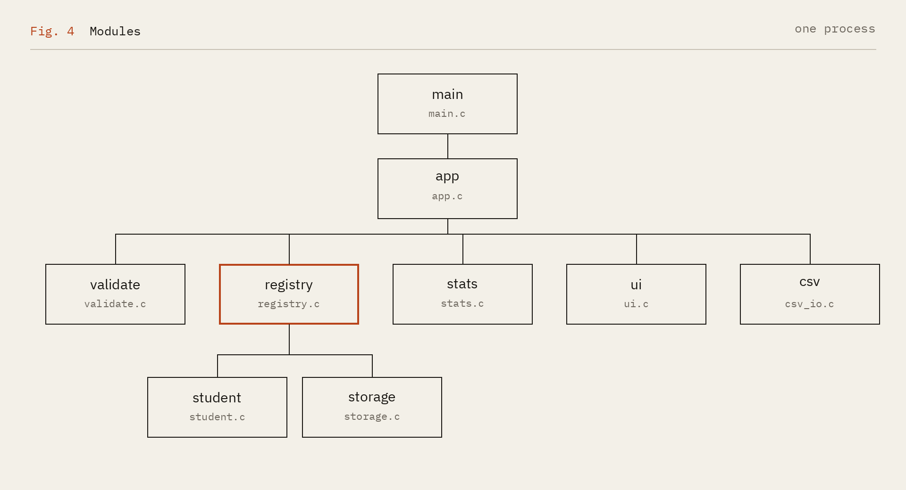
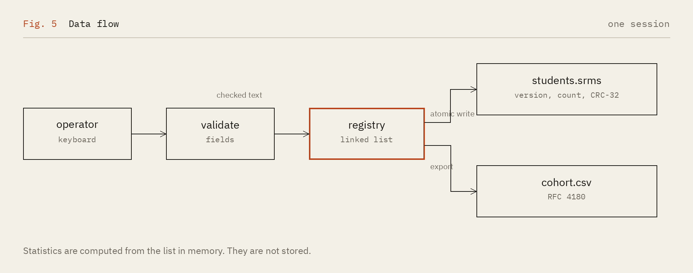

# Architecture

SRMS is one process. `main` reads arguments and chooses colour. `app` runs the session. Everything else is a library that does not print.

<picture>
  <source media="(prefers-color-scheme: dark)" srcset="assets/fig-04-modules-dark.png">
  
</picture>

The vector plate is [`fig-04-modules.svg`](assets/fig-04-modules.svg).

| Module | Owns |
| --- | --- |
| `main.c` | Arguments, `NO_COLOR`, the exit code |
| `app.c` | The session loop, prompts, the dirty flag |
| `registry.c` | The list, roll assignment, search, stable sort |
| `student.c` | Percentage and grade of one record |
| `validate.c` | Names, programmes, years, marks, rolls |
| `storage.c` | Format version 1, CRC-32, atomic replace |
| `stats.c` | Average, median, bins, highest three |
| `csv_io.c` | RFC 4180 export and import |
| `ui.c` | The 72-column screens |

A failed load builds a temporary list and throws it away. The caller's list is replaced only after the checksum and every record have been accepted.

<picture>
  <source media="(prefers-color-scheme: dark)" srcset="assets/fig-05-flow-dark.png">
  
</picture>

Statistics are a read of the list. They are not written back.

## Cost

`n` is the number of records, at most 10,000.

| Operation | Cost |
| --- | --- |
| Add, with the smallest free roll | O(n) |
| Delete or find by roll | O(n) |
| Search | O(n · length of the query) |
| Sort | O(n log n), stable, in place aside from recursion |
| Save or load | O(n) plus the checksum |
| Statistics | O(n log n) for the median sort |

## Screen

`ui.c` draws a left-aligned column, two spaces in, 72 characters wide. With colour on, the ground is `#F3F0E8`, the text is `#1A1814`, secondary text is `#6E685F`, and the accent is `#B8431A`. The accent is used for the wordmark, the menu numbers, the figure numbers, and the word `Error`.
